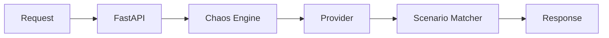

# Architecture Overview

Cloudmesh AI llm-mock is designed as a **Mock Service**, providing a thin, OpenAI-compatible layer over a set of simulated LLM providers. It focuses on simulating not just the "happy path" of an AI response, but the complex, often unpredictable nature of production LLM APIs.

## System Components

### 1. Mock API Server (FastAPI)
The server implements the standard OpenAI REST API. It acts as the entry point for external applications.

- **Request Validation**: Uses Pydantic to ensure incoming requests match the OpenAI specification.
- **Routing**: Maps API endpoints (like `/v1/chat/completions`) to the internal provider logic.
- **Dynamic Dispatch**: Routes requests to different `BaseProvider` implementations based on the `model` parameter in the request.
- **Quirk Formatting**: Before returning a response or error, the server applies a **Provider Quirk Profile** to ensure the response headers and error bodies match the real-world provider being simulated.

### 2. The Chaos Engine
Located within the server state, the Chaos Engine intercepts requests to simulate real-world instability:

- **Failure Injection**: Randomly injects 429 (Too Many Requests) or 500 (Internal Server Error) responses based on a configurable failure rate.
- **Latency Simulation**: Adds a random delay within a specified range to test client-side timeouts and loading states.
- **TPM & Context Enforcement**: Tracks "Tokens Per Minute" (TPM) and maximum context window size, returning 429 or 400 errors when limits are exceeded.
- **GPU OOM Simulation**: Maintains a set of "Loaded Models." If a request specifies a model not in this set, the server returns a 404, simulating an Out-of-Memory error on the provider side.
- **Meltdown Mode**: A catastrophic failure sequence that progresses through three stages: Max Latency $\rightarrow$ 100% Failure $\rightarrow$ Service Unavailable (503).

### 3. Scenario Manager
To provide high-fidelity responses, cmm uses a keyword-based scenario system:

- **Scenario Templates**: Predefined response patterns (e.g., "Safety Refusal", "Hallucination").
- **Keyword Matching**: The manager scans the user prompt for specific keywords. If a match is found, the corresponding scenario template is used instead of the generic response.
- **Runtime Management**: Scenarios can be created, edited, or deleted via the Admin GUI and are persisted to `~/.config/cloudmesh/scenarios.json`.

### 4. Provider Abstraction Layer
To simulate different LLM behaviors, the project uses a provider pattern:

- **`BaseProvider`**: An abstract base class defining the required interface (`prompt`, `list_models`, `tokenize`).
- **Concrete Providers**: Specific implementations (e.g., `OllamaProvider`, `AnthropicProvider`) that define their own model lists and quirk profiles.

### 5. Control Interfaces
- **CLI Orchestrator**: A `cmm` command for server management, quick prompting, and provider configuration.
- **User Chat UI**: A polished frontend for interacting with the mock LLM and visualizing latency.
- **Admin Dashboard**: A real-time control panel for the Chaos Engine and Scenario Manager.

## Data Flow
`External Request` $\rightarrow$ `FastAPI Route` $\rightarrow$ `Chaos Engine Check` $\rightarrow$ `Provider Factory` $\rightarrow$ `Scenario Matcher` $\rightarrow$ `Deterministic Mock Response` $\rightarrow$ `Quirk Profile Formatting` $\rightarrow$ `OpenAI-Formatted JSON`

